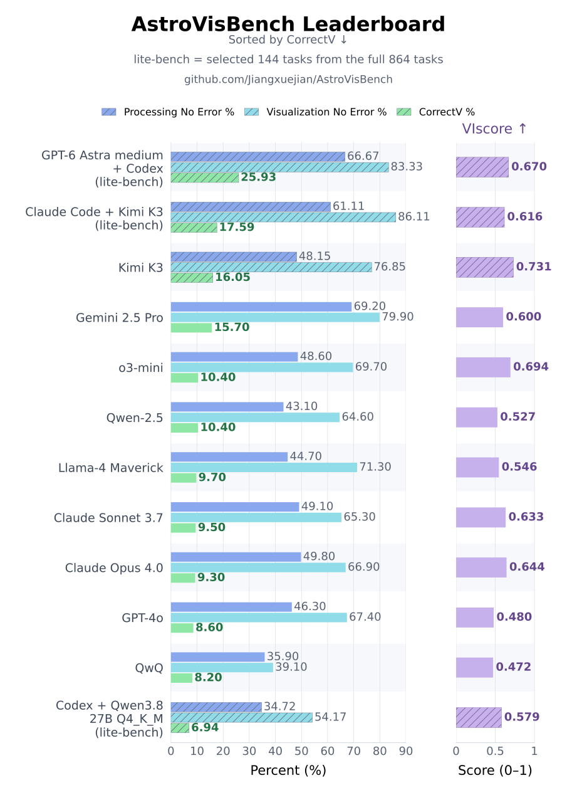

# AstroVisBench independent evaluations

## TL;DR

- How well can AI analyse astronomical data and make scientifically correct plots?
- **Lite-72** tests 72 workflows: 72 analysis tasks and 72 visualization tasks, selected from the full 432-workflow benchmark.
- [See the results](docs/index.md), [get the data (~9.9 GB)](docs/lite72-data-release.md), or [ask your agent to run the benchmark](LITE72_AGENT_PROMPT.md).

This fork adds independent evaluations and a lower-cost subset to
[AstroVisBench](https://github.com/NSF-Simons-CosmicAI-Institute/AstroVisBench).
It follows the original generation → execution → judging workflow and is not
the official leaderboard.

## Results

**CorrectV** is the percentage of all visualization tasks judged free of errors.
A program that runs successfully is not necessarily scientifically correct.
**VIscore** measures agreement with reference data products among eligible
successful processing runs. The fourth bar shows **VIscore × 100**; the table
retains its original 0–1 scale. Higher is better.

Display order uses **(100 × VIscore + CorrectV) / 2**, with equal weights.
This is a browsing index, not an official benchmark score; its two components
have different denominators and should also be read separately.

The figure includes full-benchmark and Lite results. Tool-assisted agents and
models without tools are different experiments; the display is not a controlled
ranking across tracks. Qwen's recovery run includes extra attempts.
See the [full table, metric definitions and limitations](docs/index.md).

## Run Lite-72

1. [Download and prepare the data](docs/lite72-data-release.md).
2. Give your coordinating agent the [benchmark prompt](LITE72_AGENT_PROMPT.md). New runs default to [T1](docs/T1_PROTOCOL.md): bounded tool use with up to three candidate checks per stage.
3. [Package and submit your results](docs/SUBMIT_RESULTS.md) for maintainer-side scoring. You do not need judge credentials.

Data downloads: [GitHub](https://github.com/Jiangxuejian/AstroVisBench/releases/tag/lite72-data-20261109) · [GitLab](https://gitlab.zhejianglab.com/jiangxuejian/astrovisbench-lite/-/tree/data/lite72-20261109-curated-v1/lite72-data/20261109-curated-v1).

T1 requires verified external controls; otherwise stop and ask. No-tool T0 or
unverified agent-pilot runs require explicit selection and separate reporting.

Lite-72 spans spectroscopy, photometry, imaging, time series, cosmology and
simulation/modeling, using provisional notebook-family labels. It is a fixed
sample, not a replacement for the full benchmark.

Some tasks still need online services. Keep reference solutions hidden from
the evaluated model. The shared data include a declared compact NIRISS variant;
record the input version when comparing new runs.

[Detailed methods and run records](docs/lite72-v2-historical.md) ·
[GitLab mirror](https://gitlab.zhejianglab.com/jiangxuejian/astrovisbench-lite/) ·
[Original paper](https://arxiv.org/abs/2505.20538) ·
[Official leaderboard](https://astrovisbench.github.io/)
