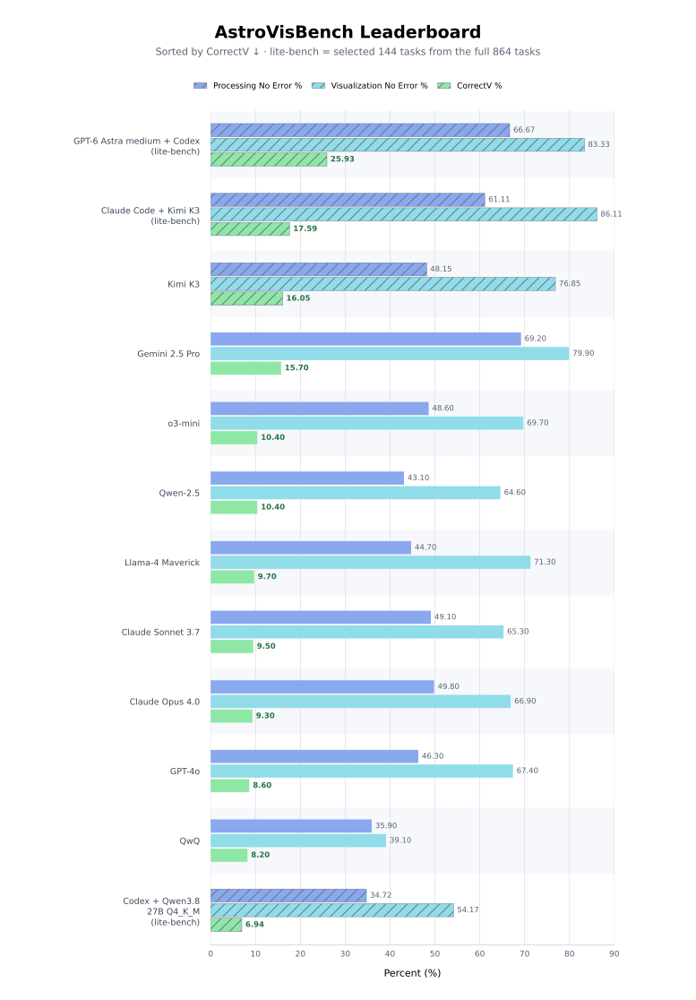

# AstroVisBench independent evaluations

This fork of the
[original AstroVisBench repository](https://github.com/NSF-Simons-CosmicAI-Institute/AstroVisBench)
adds independently run model evaluations, reproducibility records, and a fixed
lower-cost benchmark subset. It does not replace the upstream benchmark or its
official leaderboard.

## What this fork adds

- An [independent results page](docs/index.md) with audited Full-432 and Lite-72
  results.
- Full-432 local evaluations for Qwen3.8-27B Q4_K_M and Kimi K3.
- Separate Lite-72 T1 coding-agent evaluations for GPT-6 + Codex and Claude Code + Kimi K3, plus a labelled Codex + Qwen recovery track.
- A frozen, deterministic [Lite-72 subset manifest](docs/data/lite72-candidate-v1.json),
  [UID selector](scripts/select_lite72_subset.py), and
  [reproducibility guide](LITE72_RUN_GUIDE.md).
- Machine-readable provenance and leaderboard data under [docs/data](docs/data/).

Lite-72 is a complete evaluation of a fixed sampled subset—not an unfinished
Full-432 run. Standard no-tool model runs and coding-agent runs are reported as
separate tracks because their tool access and interaction protocols differ.

## Current snapshot

The chart combines published reference rows from the official AstroVisBench
leaderboard with clearly labelled independent results from this fork. Hatched
bars identify local evaluations. The **portrait horizontal chart** includes
only **Full-432 and Lite-72 v2 task-selection** results, sorted by **CorrectV,
highest first**. Suite/track labels distinguish reference, no-tool, T1 and
recovery runs. This is a display order, not a controlled cross-track ranking.
Lite-72 v1 is excluded from the current figure/table; its historical audit is retained.

See the [full table, metric definitions, and provenance](docs/index.md).
Both [SVG](docs/assets/leaderboard-portrait.svg) and
[PNG](docs/assets/leaderboard-portrait.png) are updated together.

### Latest completed results · 30 October 2026

| Coding agent | Coverage | Processing no error | Visualization no error | VIscore | CorrectV |
|---|---:|---:|---:|---:|---:|
| GPT-6 Astra medium + Codex · T1 | 72/72 | 66.67% | 83.33% | 0.6700 | 25.93% |
| Claude Code + Kimi K3 · T1 | 72/72 | 61.11% | 86.11% | 0.6162 | 17.59% |
| Codex + Qwen3.8-27B Q4_K_M · recovery | 72/72 | 34.72% | 54.17% | 0.5789 | 6.94% |

These use the **Lite-72 v2 task selection with historical inputs**, combining
65 preserved baseline executions with seven supplements for GPT-6 and Claude + K3.
They are **not official frozen-input v2 scores**. VIscore denominators are
40, 33 and 19 respectively; visualization percentages average three trials
over all 72 workflows. Judge: GPT-6 Astra medium, Codex CLI 0.153.4.

**Qwen recovery caveat:** one fresh bounded processing attempt was authorized
for tasks 51/52; only task 51 produced code and was substituted. Missing
processing tasks 17/52 count as failures, never successful blank cells. This
is not the original capped T1 baseline. Original artifacts and old v1 results
are retained. External-service timeouts and differing run conditions still
limit cross-model fairness; these are not a controlled common ranking.
See the [selection, protocol/version caveats and checksums](docs/lite72-v2-historical.md).

**23 October 2026 correction:** Kimi K3's historical execution records were
reconciled with the repaired records used for judging. Processing success is
**48.15%**, visualization success **76.85%**, and VIscore **0.731**; judge
category percentages are unchanged. Both figure formats and the table reflect
this correction. Network/input fairness is still being investigated; these
are not controlled-rerun scores. See the [audit note](docs/execution-fairness.md).

## Reproduce the Lite-72 subset

Follow [`LITE72_RUN_GUIDE.md`](LITE72_RUN_GUIDE.md) to:

1. validate the pinned 432-task source dataset and frozen UID manifest;
2. generate the exact 72-record benchmark input;
3. run the original generation, execution, visualization-judge, and aggregation
   sequence; and
4. record the model, harness, environment, tool policy, checksums, and judge
   configuration needed for comparison.

For the original environment setup, benchmark schema, usage instructions,
citation, and license, use the
[upstream README](https://github.com/NSF-Simons-CosmicAI-Institute/AstroVisBench#readme).
The [official website](https://astrovisbench.github.io/) remains the authority
for the published AstroVisBench leaderboard.
