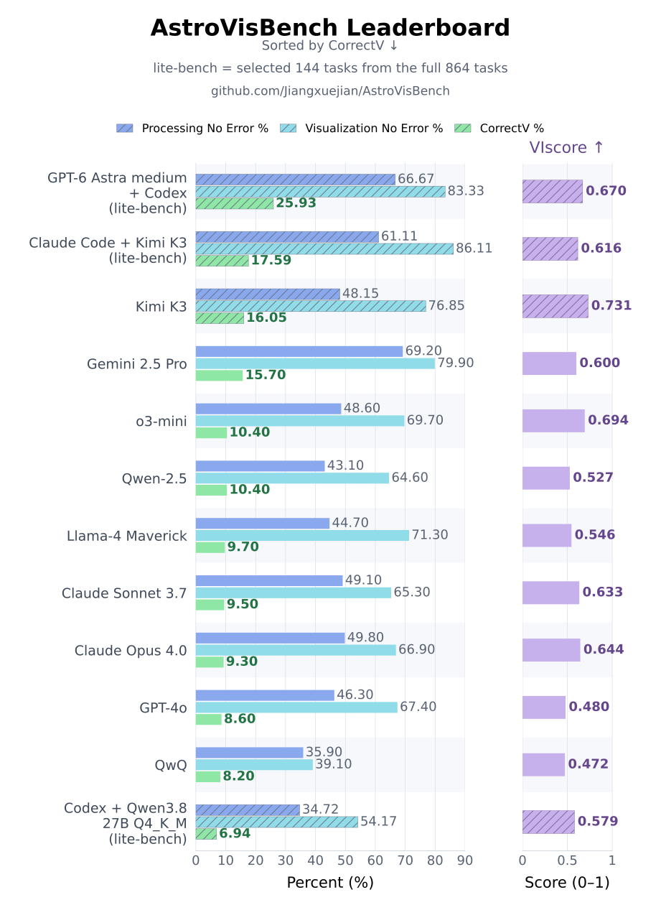

# AI for astronomical analysis and visualization

We test whether models can turn an astronomy request into working analysis code
and a scientifically correct plot. This is an independent extension of
[AstroVisBench](https://astrovisbench.github.io/), following its original workflow.

[Results](#results) · [Run Lite-72](#run-lite-72) · [Data](lite72-data-release.md) · [Detailed methods](lite72-v2-historical.md)

## What is tested?

The full benchmark contains **432 workflows**, each with an analysis task and a
visualization task. **Lite-72** is a fixed sample of 72 workflows
(**144 tasks**) for a lower-cost evaluation.

Lite covers spectroscopy, photometry, imaging, time series, cosmology and
simulation/modeling using provisional source-notebook families. It is not
guaranteed to reproduce full-benchmark scores or model rankings.

## Results

*Results through 30 October 2026. Data-sharing guide updated 9 November.*

Hatched bars are our independent runs; `(lite-bench)` marks Lite-72.
Models are displayed by CorrectV, but differences in task sample, tools,
judge and execution conditions mean this is **not one controlled ranking**.
The no-tool Qwen result appears in the table only.
[Download PNG](assets/leaderboard-portrait.png).

| Model | Suite / track | Processing no error ↑ | VIscore ↑ | Visualization no error ↑ | CorrectV ↑ | VisFail ↓ | Minor error ↓ | Major error ↓ |
|---|---|---:|---:|---:|---:|---:|---:|---:|
| GPT-6 Astra medium + Codex§ | (lite-72 v2 selection) historical inputs, T1 | 66.67% | 0.6700 | 83.33% | 25.93% | 8.33% | 25.00% | 24.07% |
| Claude Code + Kimi K3§ | (lite-72 v2 selection) historical inputs, T1 | 61.11% | 0.6162 | 86.11% | 17.59% | 12.50% | 21.76% | 34.26% |
| Kimi K3† | Full-432 · independent no-tool | 48.15% | 0.731 | 76.85% | 16.05% | 10.88% | 18.13% | 31.79% |
| Gemini 2.5 Pro | Full-432 · published reference | 69.20% | 0.600 | 79.90% | 15.70% | 9.30% | 25.90% | 28.50% |
| o3-mini | Full-432 · published reference | 48.60% | 0.694 | 69.70% | 10.40% | 2.80% | 26.40% | 29.60% |
| Qwen-2.5 | Full-432 · published reference | 43.10% | 0.527 | 64.60% | 10.40% | 3.70% | 20.10% | 29.90% |
| Llama-4 Maverick | Full-432 · published reference | 44.70% | 0.546 | 71.30% | 9.70% | 9.00% | 21.50% | 30.60% |
| Claude Sonnet 3.7 | Full-432 · published reference | 49.10% | 0.633 | 65.30% | 9.50% | 21.30% | 14.60% | 19.20% |
| Claude Opus 4.0 | Full-432 · published reference | 49.80% | 0.644 | 66.90% | 9.30% | 12.70% | 28.90% | 16.00% |
| GPT-4o | Full-432 · published reference | 46.30% | 0.480 | 67.40% | 8.60% | 6.00% | 23.40% | 28.50% |
| QwQ | Full-432 · published reference | 35.90% | 0.472 | 39.10% | 8.20% | 3.90% | 12.60% | 14.90% |
| Qwen3.8-27B Q4_K_M† | Full-432 · independent no-tool | 32.18% | 0.474 | 52.55% | 7.18% | 9.95% | 10.49% | 24.92% |
| Codex + Qwen3.8-27B Q4_K_M¶ | (lite-72 v2 selection) historical inputs, recovery | 34.72% | 0.5789 | 54.17% | 6.94% | 9.72% | 9.26% | 28.24% |

† Independent full-benchmark model runs without tools.
§ Tool-assisted agents on the current Lite-72 selection.
¶ A separate Qwen recovery run with extra attempts; missing submissions count
as failures. See the [run records](lite72-v2-historical.md).

### How to read the scores

| Metric | Scientific interpretation |
|---|---|
| Processing no error | Analysis code ran without crashing—not proof that its answer is correct. |
| VIscore | Agreement with reference data products among eligible successful analysis runs. Higher is better. |
| Visualization no error | Plotting code ran without crashing. |
| CorrectV | Visualizations judged to have no errors. Higher is better. |
| VisFail | Outputs that do not meet the single-visualization requirement. |
| Minor / Major error | Visualizations judged to contain the corresponding errors. Lower is better. |

Visualization percentages average three judgments over all workflows, including
execution failures. Local judgments use GPT-6 Astra medium, not human expert
validation; judging GPT-6's own outputs may introduce bias.

Network failures and differing inputs can affect scores. The existing Lite
results use historical inputs, not a fully offline benchmark. K3's historical
bookkeeping correction is included. Details are retained in the
[execution audit](execution-fairness.md) and
[model-by-model run records](lite72-v2-historical.md).

## Run Lite-72

1. [Prepare the data](lite72-data-release.md): about **9.9 GB** to download; allow **50 GB free**, plus scientific software and execution outputs.
2. Give your coordinating agent the [run prompt](../LITE72_AGENT_PROMPT.md). It preserves the original task definitions and evaluation procedure.
3. [Package and submit your results](SUBMIT_RESULTS.md) to the maintainer for common judging. You do not need to run a judge.

The workflow is **prepare → generate → execute → judge → aggregate**.
Standard model runs have no tools; coding-agent runs declare their tools and
budgets separately. Reference answers and hidden tests stay unavailable to the
evaluated agent. As upstream, visualization tasks receive reference processing
code rather than the model's own analysis output.

Use the current **v2 task selection**. The older v1 study is
[archived](../LITE72_RUN_GUIDE.md); do not mix the selections.
A fully offline data release is still in development.

## Credits

AstroVisBench was introduced by Sebastian Antony Joseph and collaborators.
Please cite the original work and distinguish these independent evaluations
from the authors' published results.

[Paper](https://arxiv.org/abs/2505.20538) ·
[Original code](https://github.com/NSF-Simons-CosmicAI-Institute/AstroVisBench) ·
[Dataset](https://huggingface.co/datasets/sebajoe/AstroVisBench) ·
[Official leaderboard](https://astrovisbench.github.io/) ·
[Reproducibility records](data/leaderboard.json)
