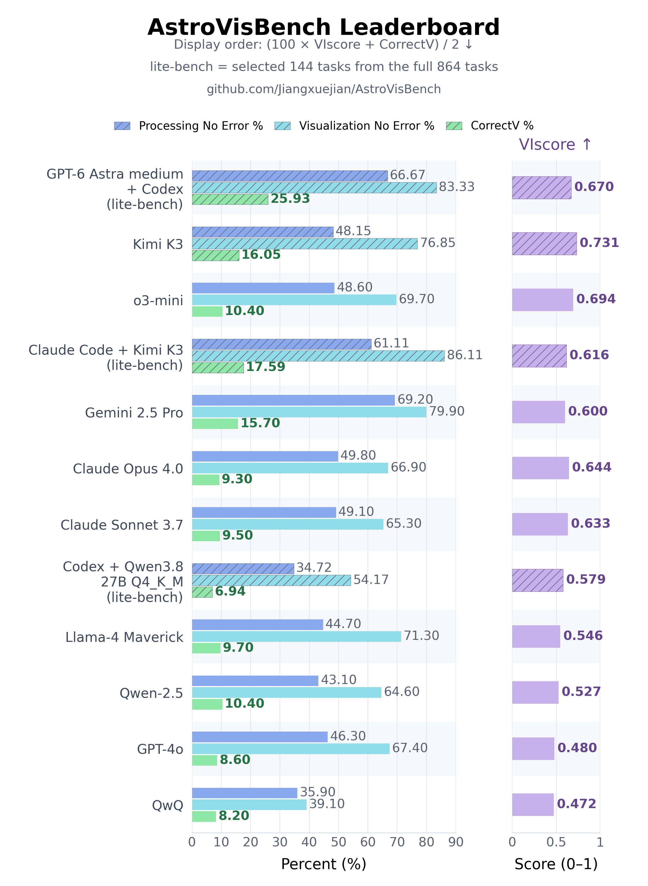

# Leaderboard 20261101

Frozen version label **20261101**; assembled on **2026-11-13** (Asia/Shanghai).
The version label is not the execution or publication date. Scores are the
existing historical results; this snapshot introduces no reference repairs or
new scientific evaluation rules. Lite rows use the **Lite-72 v2 task selection**.

[SVG](leaderboard.svg) · [Score data](leaderboard.json) ·
[Checksums and version metadata](manifest.json) · [Current results](../../index.md)

VIscore uses the separate **0–1 panel** and is conditional on eligible successful
processing runs. Reference coverage is incomplete; treat these historical VI
scores as provisional. The display index is not an official benchmark metric.
Different samples, tools, judges and recovery budgets are not a controlled ranking.

| Model | Suite / track | Processing no error ↑ | VIscore ↑ | Visualization no error ↑ | CorrectV ↑ | VisFail ↓ | Minor error ↓ | Major error ↓ |
|---|---|---:|---:|---:|---:|---:|---:|---:|
| GPT-6 Astra medium + Codex§ | (lite-72 v2 selection) historical inputs, T1 | 66.67% | 0.6700 | 83.33% | 25.93% | 8.33% | 25.00% | 24.07% |
| Kimi K3† | Full-432 · independent no-tool | 48.15% | 0.731 | 76.85% | 16.05% | 10.88% | 18.13% | 31.79% |
| o3-mini | Full-432 · published reference | 48.60% | 0.694 | 69.70% | 10.40% | 2.80% | 26.40% | 29.60% |
| Claude Code + Kimi K3§ | (lite-72 v2 selection) historical inputs, T1 | 61.11% | 0.6162 | 86.11% | 17.59% | 12.50% | 21.76% | 34.26% |
| Gemini 2.5 Pro | Full-432 · published reference | 69.20% | 0.600 | 79.90% | 15.70% | 9.30% | 25.90% | 28.50% |
| Claude Opus 4.0 | Full-432 · published reference | 49.80% | 0.644 | 66.90% | 9.30% | 12.70% | 28.90% | 16.00% |
| Claude Sonnet 3.7 | Full-432 · published reference | 49.10% | 0.633 | 65.30% | 9.50% | 21.30% | 14.60% | 19.20% |
| Codex + Qwen3.8-27B Q4_K_M¶ | (lite-72 v2 selection) historical inputs, recovery | 34.72% | 0.5789 | 54.17% | 6.94% | 9.72% | 9.26% | 28.24% |
| Llama-4 Maverick | Full-432 · published reference | 44.70% | 0.546 | 71.30% | 9.70% | 9.00% | 21.50% | 30.60% |
| Qwen-2.5 | Full-432 · published reference | 43.10% | 0.527 | 64.60% | 10.40% | 3.70% | 20.10% | 29.90% |
| GPT-4o | Full-432 · published reference | 46.30% | 0.480 | 67.40% | 8.60% | 6.00% | 23.40% | 28.50% |
| QwQ | Full-432 · published reference | 35.90% | 0.472 | 39.10% | 8.20% | 3.90% | 12.60% | 14.90% |
| Qwen3.8-27B Q4_K_M† | Full-432 · independent no-tool | 32.18% | 0.474 | 52.55% | 7.18% | 9.95% | 10.49% | 24.92% |

† Independent full-benchmark no-tool runs. § Historical Lite-72 T1 agents.
¶ Separate recovery run with extra attempts.
See [methods and limitations](../../lite72-v2-historical.md).

Evidence files in `data/` are frozen public audit exports, not raw submissions
or benchmark input data. Future updates must create a new version folder rather
than overwrite this one.
